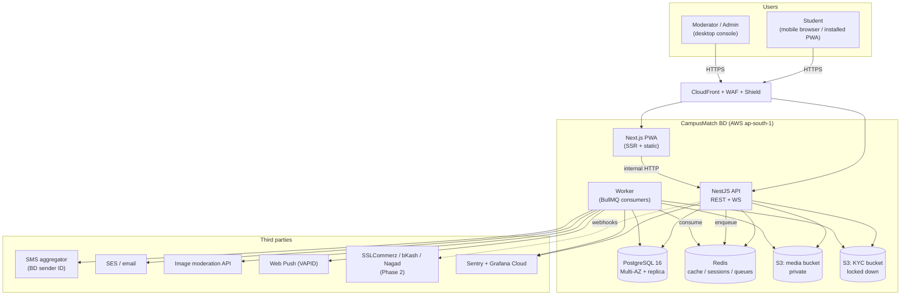
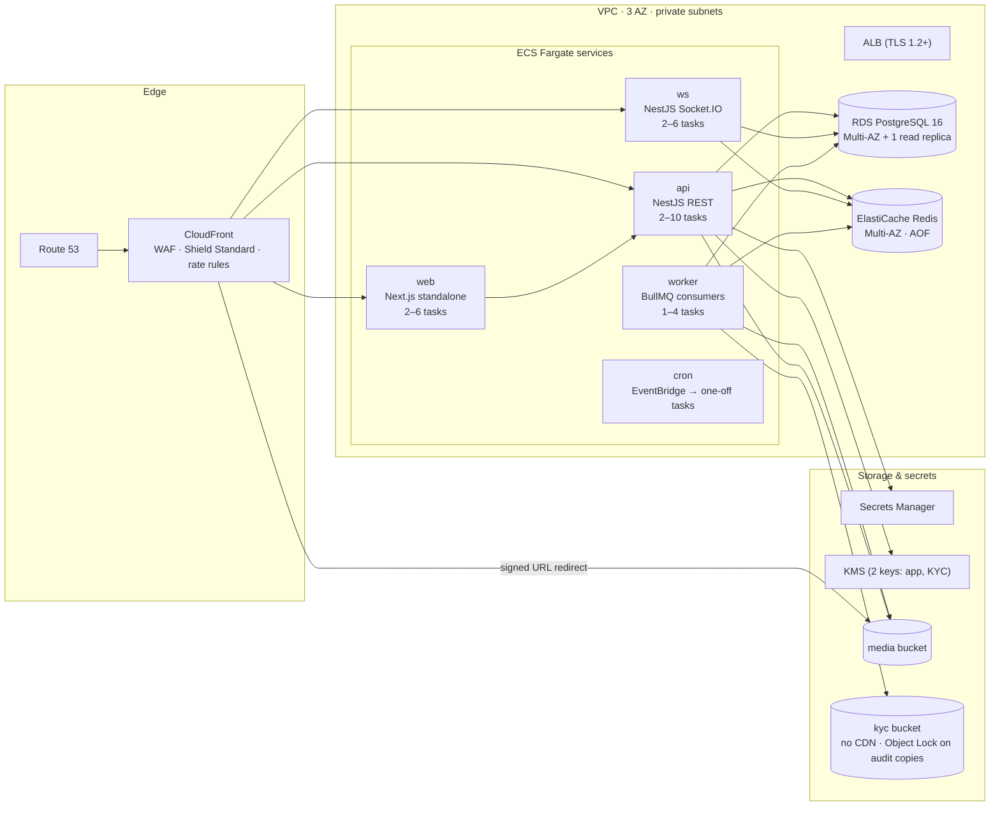
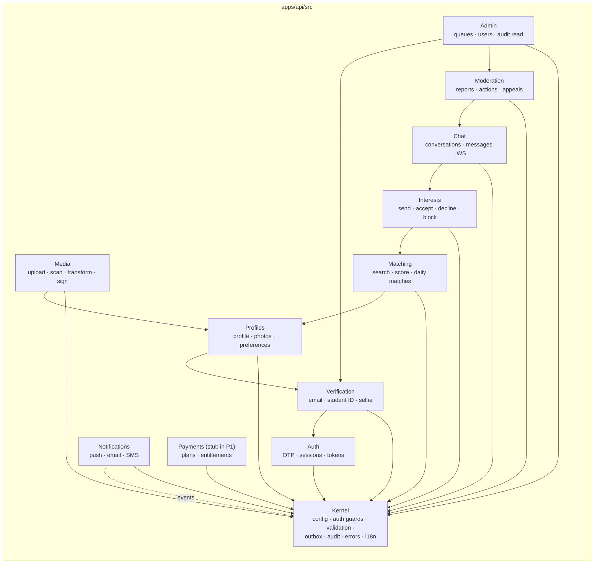
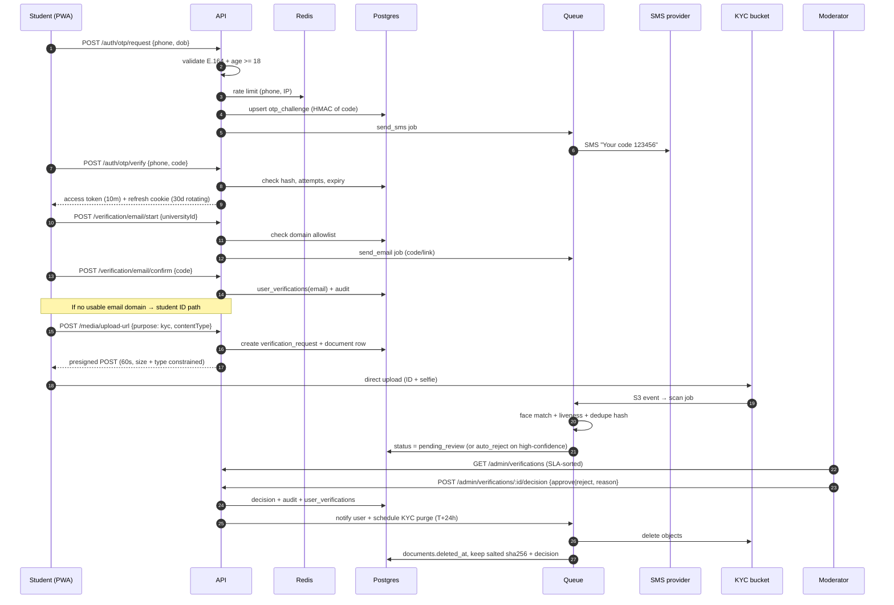
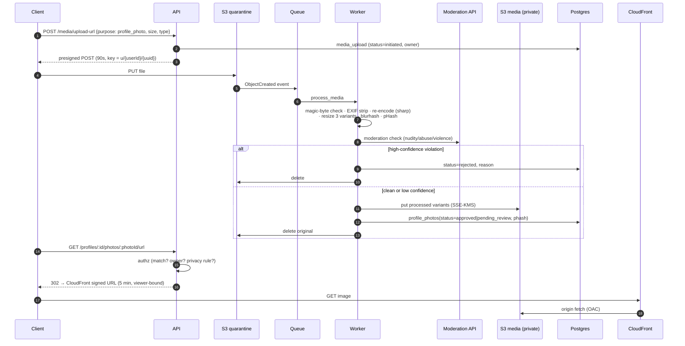
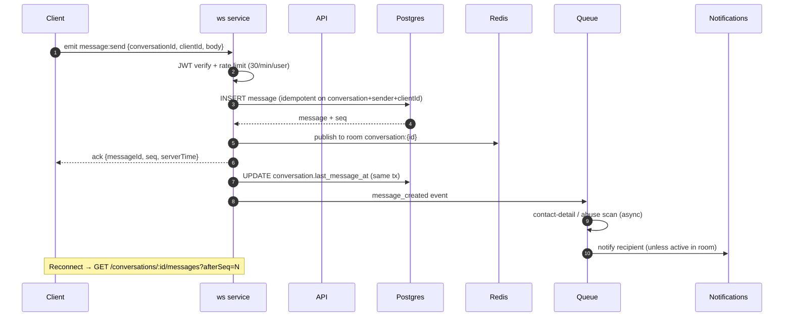
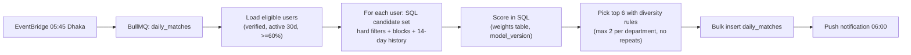

# CampusMatch BD — System Architecture

| | |
|---|---|
| **Version** | 0.1 |
| **Date** | 2026-11-01 |
| **Style** | Modular monolith, single deployable API + separate worker and WebSocket processes |
| **Cloud** | AWS `ap-south-1` (Mumbai), 3 AZs; DR copy in `ap-southeast-1` (Singapore) |

---

## 1. Architecture principles

1. **One database, one repository, one deploy.** Modules are separated by code boundaries and PostgreSQL schemas, not by network calls. This keeps transactions simple (match + conversation creation must be atomic) and ops cheap.
2. **Async by default for anything slow.** Image scanning, notifications, emails, SMS, daily match generation, exports, and deletions go through a queue. A request never waits on a third party.
3. **The API is the only trust boundary.** Every authorization decision happens server-side; the PWA is treated as hostile.
4. **Two storage planes.** User media and identity documents are never in the same bucket, never share a policy, and never share a CDN.
5. **Design for the split, don't build it.** Chat and Media are the two modules most likely to leave the monolith. They already communicate only through interfaces + domain events, so extraction is a transport change, not a rewrite.
6. **Buy the undifferentiated parts.** Managed Postgres, managed Redis, managed KMS, managed moderation API. Custom code is reserved for matching, trust, and the campus experience.

---

## 2. System context

**Trust boundaries:** the browser (untrusted), the CDN/WAF (semi-trusted), the VPC (trusted), the KYC bucket (restricted, separate KMS key, separate IAM role, access logged per object).

---

## 3. Container / deployment view

### Why these choices

| Decision | Choice | Why | Rejected alternative |
|---|---|---|---|
| Compute | **ECS Fargate** | No cluster to operate, per-second billing, rolling + blue/green via CodeDeploy, simple autoscaling on ALB request count | EKS (ops overhead at this team size), Lambda (cold starts, 15-min cap, WS pain), EC2 (patching burden) |
| API framework | **NestJS 11 + Fastify adapter** | Modules/DI map cleanly to the modular monolith; guards/interceptors give one enforcement point for authz, validation, audit; Fastify ~2× throughput of Express | Django (fine, but one language across stack wins), plain Fastify (weak structure for 8 modules) |
| Frontend | **Next.js 15 App Router** | SSR for fast first paint on slow networks, RSC keeps JS small, image optimisation, first-class PWA support | SPA-only React (worse TTFB on 3G), Remix (smaller ecosystem) |
| ORM | **Prisma + raw SQL for search/matching** | Type-safe schema + migrations for 95% of queries; `$queryRaw` for FTS, scoring, keyset pagination | Drizzle (good, less mature migration story), TypeORM (weaker types) |
| DB | **RDS PostgreSQL 16, Multi-AZ** | ACID for match/chat invariants, JSONB for flexible filters, row-level security, `pg_trgm` + FTS, PITR | Aurora (2× cost at this size), MongoDB (no joins/transactions we need), MySQL (weaker JSON/FTS/RLS) |
| Cache/queue | **ElastiCache Redis 7 + BullMQ** | One system for cache, rate limits, sessions, and jobs; BullMQ has retries, backoff, cron, dedupe | SQS+SNS (great, but two more systems; revisit for critical notifications), RabbitMQ (heavier) |
| Realtime | **Socket.IO on a separate `ws` service with Redis adapter** | Sticky-session-free fan-out, fallback to long-polling on flaky mobile networks, room-per-conversation | Raw WS (no fallback), Pusher/Ably (cost at scale, data residency) |
| Media | **S3 private + CloudFront signed URLs** | No public objects; per-viewer expiry; cheap egress via CDN | Public buckets (never), Cloudinary (extra processor + cost, but viable Phase 2) |
| KYC docs | **Separate S3 bucket, separate KMS key, no CDN, 24h lifecycle** | Blast-radius isolation; a media-bucket misconfiguration cannot expose IDs | Same bucket with prefixes (insufficient isolation) |
| Search | **PostgreSQL now** | 600–5,000 profiles per campus; structured filters + trgm is plenty | OpenSearch at launch (cost + ops for no benefit) |
| IaC | **Terraform** | Team familiarity, mature AWS provider, easy review | CDK (fine, but Terraform is the safer hiring bet) |
| Email/SMS | **SES + local BD aggregator** | SES cheap for transactional email; local aggregator needed for alphanumeric sender ID + delivery | Twilio (3–5× SMS cost to BD) |

---

## 4. Module boundaries (the modular monolith)

**Rules enforced in CI (`dependency-cruiser`):**

- A module may import another module **only** through its `public/` barrel (`@/modules/profiles/public`). Repositories and entities are private.
- No module imports `admin` or `moderation` internals; admin reads via query services.
- Cross-module side effects use **domain events** through the transactional outbox, not direct calls, when the effect is not required for the current transaction.
- `kernel` imports nothing from modules.

**Schema-per-module in Postgres** (`identity`, `profile`, `matching`, `chat`, `moderation`, `billing`, `ops`) makes a future extraction a `pg_dump --schema` away and makes RLS grants easier to reason about. Cross-schema foreign keys are allowed now (single DB), but no cross-schema joins inside hot paths except through read models.

**Extraction triggers (documented, not built):**

| Module | Trigger to extract | First step |
|---|---|---|
| Chat | > 50k concurrent WS or > 2k msg/s, or chat deploys blocked by API deploys | Move `ws` + `chat` schema to its own service; keep REST read API in monolith |
| Media | > 100k uploads/day or scanning backlog > 15 min | Move pipeline to a dedicated worker fleet + event bus |
| Matching | Daily batch > 30 min or > 500k profiles | Precompute in a columnar store / OpenSearch |

---

## 5. Key flows

### 5.1 Signup and verification

### 5.2 Media upload (user photos)

**Non-negotiable:** the quarantine bucket has a 24h lifecycle rule; the media bucket blocks all public access and only CloudFront's OAC can read it; signed URLs include a custom policy with the viewer's user ID so a leaked URL is useless to another account.

### 5.3 Chat message

**Design choices:**
- Messages are written to Postgres **before** fan-out; Redis is a transport, never the source of truth. A Redis flush loses nothing.
- `seq` is a per-conversation bigint from a Postgres sequence, so clients can detect gaps and resync.
- REST fallback `POST /conversations/:id/messages` exists for flaky networks and non-WS clients; both paths share the same service method.
- Not E2EE in P1 — required for abuse detection and legal compliance. Documented in-product.

### 5.4 Daily match generation (batch)

Batch size: 5k users × ≤500 candidates = 2.5M score rows — fine in SQL on a `db.r6g.large`, chunked 500 users per job. At 50k users, switch to a read replica and precomputed feature table.

---

## 6. Data architecture

| Store | Contents | Notes |
|---|---|---|
| PostgreSQL primary | All relational data, outbox, audit | Encrypted at rest (RDS KMS), TLS in transit, `pgcrypto` available but app-level envelope encryption used for phone/email |
| Read replica | Admin analytics, exports, heavy search | Lag-tolerant reads only |
| Redis | Sessions (jti denylist), rate limits, cache (profile cards, daily matches), BullMQ | AOF everysec; **no PII** in cache keys or values beyond opaque IDs |
| S3 media | Processed photos, chat attachments (P2) | SSE-KMS, versioning off, lifecycle to IA after 90 days |
| S3 KYC | ID/selfie uploads | Separate account-level bucket policy, no CDN, 24h lifecycle, access logging |
| OpenSearch | *Not used in P1* | Introduced when free-text search or >100k profiles demand it |

**Field-level encryption.** Phone and email are stored twice: `*_enc` (AES-256-GCM, envelope key from KMS, per-row IV) and `*_hmac` (HMAC-SHA256 with a separate pepper) for equality lookup and uniqueness. DOB is stored in plaintext because age filtering and matching require range queries; access is restricted by role and never returned raw by the API (only derived age). See `03-data-model.md` §7 for the data classification table.

---

## 7. Security architecture (summary — full checklist in item 5)

- **Edge:** CloudFront + AWS WAF (managed rule groups: OWASP, bot control, IP reputation), Shield Standard, geo/IP rate rules, 10 MB body cap, request body inspection on auth routes.
- **AuthN:** phone OTP → short-lived JWT (10 min, `jti`, `sid`, `ver`) + opaque rotating refresh token (30 days, hashed at rest, reuse detection revokes the family). Refresh token in `HttpOnly; Secure; SameSite=Lax` cookie scoped to `/api/v1/auth`, plus a double-submit CSRF token for state-changing requests. Staff: password (Argon2id, m=64MB, t=3) + TOTP.
- **AuthZ:** every route declares a policy (`@Policy('conversation:read')`); a central `PolicyGuard` resolves `(actor, resource, action)` and denies by default. Resource ownership is checked in the service layer too (defence in depth), never trusted from the URL alone.
- **RLS:** enabled on `chat.messages`, `chat.conversations`, `profile.profile_photos`, `identity.verification_documents`, `moderation.reports`. The API connects as a non-owner role; each request transaction runs `SET LOCAL app.user_id = ...`. Admin/worker roles bypass RLS explicitly. Details in `03-data-model.md` §6.
- **Secrets:** Secrets Manager + IAM task roles; no secrets in env files, no secrets in the Next.js bundle; rotation runbook for DB, JWT keys (kid-based), SMS, moderation API.
- **Uploads:** presigned POST with content-length-range and content-type conditions; magic-byte validation; re-encode everything; strip EXIF; ClamAV scan; no SVG; no PDF for user media.
- **Headers:** strict CSP (`default-src 'self'`, nonce-based script-src, `img-src` limited to CDN + `data:` for blurhash), HSTS 1 year, `X-Content-Type-Options`, `Referrer-Policy: strict-origin-when-cross-origin`, `Permissions-Policy` denying camera/mic except on the verification and call routes, COOP/CORP.
- **Audit:** append-only `ops.audit_logs`, written by an interceptor + explicit domain events; includes request ID so it can be joined to traces.

---

## 8. Reliability and operations

| Concern | Approach |
|---|---|
| Multi-AZ | RDS Multi-AZ, ElastiCache Multi-AZ, ECS tasks spread across 3 AZs, ALB cross-zone |
| Health | `/health/live` (process) and `/health/ready` (DB + Redis + queue depth); ALB uses ready |
| Autoscaling | API on CPU 60% + ALB requests/target 800; WS on connection count; worker on queue depth |
| Deploy | Immutable ECR image (digest pinned), ECS rolling with `minimumHealthyPercent=100`, circuit breaker + auto-rollback; blue/green for schema-coupled releases |
| Migrations | Expand → migrate → contract. Every migration backward compatible with the previous app version; no destructive change in the same release |
| Backups | RDS automated daily + PITR 35 days; cross-region snapshot copy nightly; S3 versioning off but KYC purge is audited; quarterly restore drill into an isolated account |
| DR | RPO ≤ 5 min (PITR), RTO ≤ 4 h (restore + DNS failover runbook). Warm standby is a Phase 2 cost decision |
| Degradation | SMS down → voice OTP fallback + queue retry. Moderation API down → uploads held `pending`, user sees "under review". Redis down → API serves read-only cached paths, chat falls back to REST polling, rate limits fail closed on auth routes |
| Observability | OpenTelemetry traces → Grafana Tempo; metrics → CloudWatch + Grafana; errors → Sentry (PII scrubbed); logs JSON, 30-day retention, no message bodies; synthetic checks from Dhaka + Singapore every minute; public status page |
| Alerts | Page: 5xx > 1% for 5 min, p95 > 1s for 10 min, queue depth > 5k for 15 min, RDS failover, KYC purge failure, moderation backlog > 2h, auth failure spike, WAF block spike |

**SLOs:** API availability 99.9%; chat message delivery p95 < 500 ms; verification decision p95 < 48h; report P0 triage p95 < 2h; image processing p95 < 60 s.

---

## 9. Environments and delivery

| Env | Purpose | Data | Access |
|---|---|---|---|
| `local` | Dev | Docker Compose (Postgres, Redis, MinIO, MailHog) + seeded synthetic profiles | Developer laptop |
| `staging` | Pre-prod, mirrors prod topology at 1/4 scale | Synthetic + a small consented internal pilot set; **never** real KYC docs | Team + QA, SSO + IP allowlist |
| `prod` | Live | Real | Break-glass only, all actions audited |

Separate AWS accounts per env (Organizations + SCPs). Terraform state in S3 with DynamoDB locking; `plan` posted on every PR via OIDC (no long-lived AWS keys in CI).

**Pipeline (GitHub Actions):**

1. PR: lint, typecheck, unit, `dependency-cruiser` boundary check, i18n key parity, OpenAPI diff, Gitleaks, `osv-scanner`/`npm audit`, CodeQL, Terraform plan.
2. Merge to `main`: build images (SBOM + cosign), integration tests with Testcontainers, migration dry-run on a prod-like snapshot.
3. Auto-deploy staging → smoke + Playwright E2E + ZAP baseline → manual approval.
4. Prod: ECS rolling deploy, canary 10% for 10 min (ALB weighted target groups), auto-rollback on 5xx/latency; feature flags for risky surfaces.
5. Nightly: full E2E, dependency scan, DAST against staging, restore drill weekly.

---

## 10. What this architecture deliberately does *not* do

- No microservices, no service mesh, no Kafka. At 5k–50k users these add cost and failure modes without benefit.
- No E2EE chat in P1 (moderation and legal obligations win; revisit with a safety-preserving design in P3).
- No client-side-only authorization, no "admin" flag in a JWT that the client can influence.
- No public S3 objects, no long-lived signed URLs, no EXIF-bearing images.
- No third-party analytics that could deanonymise students.
- No cross-border KYC processing beyond the cloud region (Mumbai) without explicit consent and legal review.
