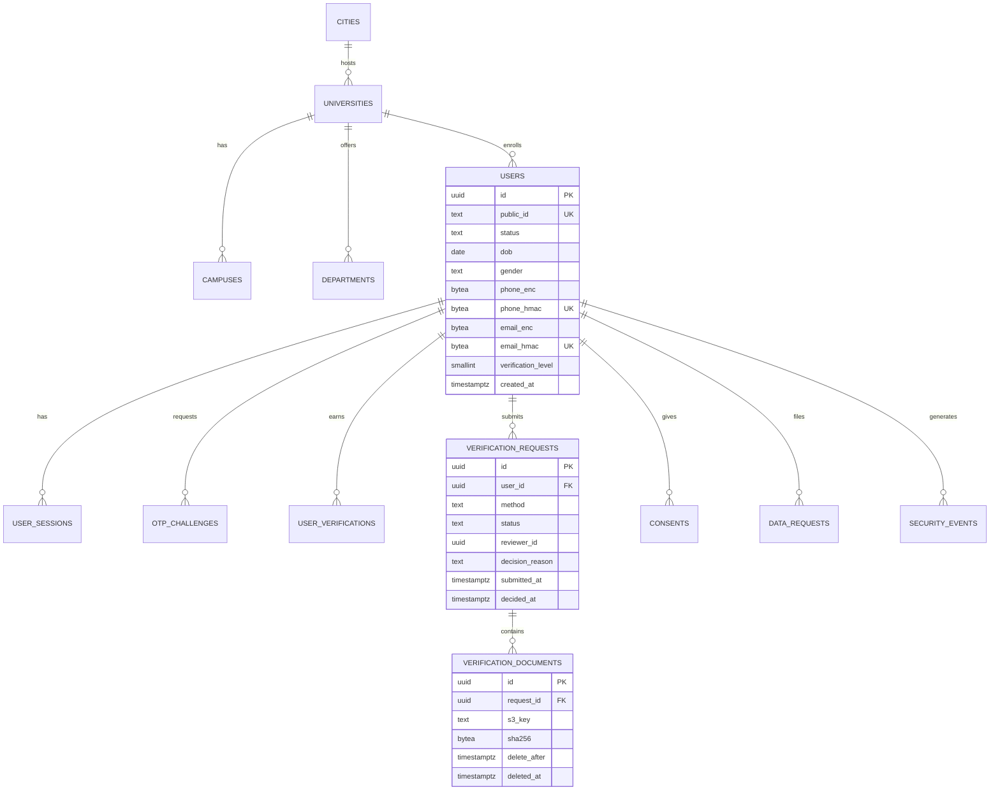
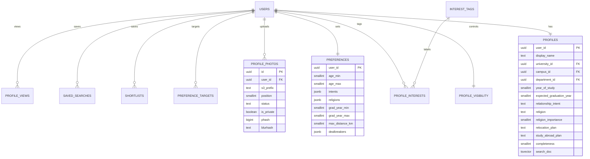
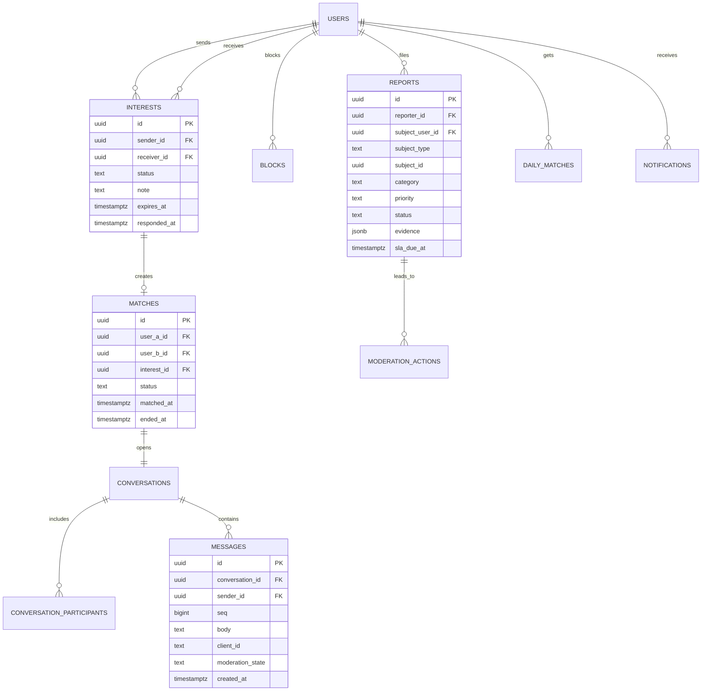
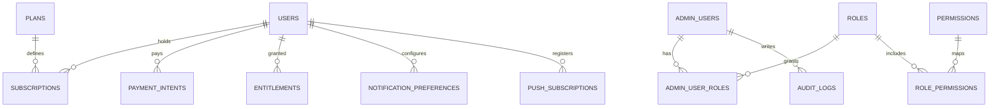

# CampusMatch BD — Data Model, Indexes, RLS and Retention

| | |
|---|---|
| **Version** | 0.1 |
| **Database** | PostgreSQL 16 (RDS, Multi-AZ + 1 read replica) |
| **Schemas** | `identity`, `profile`, `matching`, `chat`, `moderation`, `billing`, `ops` |
| **ORM** | Prisma (schema per module via `multiSchema`), raw SQL for search/scoring |

---

## 1. Conventions

| Convention | Rule |
|---|---|
| Primary keys | `uuid` generated in the app as **UUIDv7** (time-ordered, index-friendly). `gen_random_uuid()` only as a fallback. |
| Public identifiers | `users.public_id` = 12-char base62, unique, used in URLs and APIs. Internal UUIDs never leave the server. |
| Time | `timestamptz` everywhere, stored UTC, rendered in `Asia/Dhaka`. |
| Enums | `text` + `CHECK (col IN (...))` instead of PG enums — cheap to evolve, no `ALTER TYPE` locks. |
| Money | `integer` paisa (BDT × 100). Never float. |
| Soft delete | `deleted_at timestamptz` only where recovery or abuse review matters; everything else is hard-deleted by a purge job. |
| PII | Phone/email stored as `*_enc bytea` (AES-256-GCM) + `*_hmac bytea` (HMAC-SHA256, unique). |
| IP | Never raw. `ip_hash bytea` (HMAC for correlation) + `ip_prefix inet` (v4 /24, v6 /48). |
| Naming | `snake_case`, singular table names, `*_id` FKs, `created_at`/`updated_at` on every mutable table. |
| FKs | `ON DELETE CASCADE` for owned children, `ON DELETE RESTRICT` for reference data. |
| Constraints | Business invariants live in the DB where cheap (`CHECK (user_a_id < user_b_id)`, partial unique indexes). |

---

## 2. Entity-relationship overview

### 2.1 Identity and verification



### 2.2 Profile and preferences



### 2.3 Matching, interaction and chat



### 2.4 Billing and operations



---

## 3. Table specifications

### 3.1 `identity` schema

#### `cities`
| Column | Type | Notes |
|---|---|---|
| `id` | uuid PK | |
| `name_en`, `name_bn` | text NOT NULL | |
| `division` | text NOT NULL | Dhaka, Chattogram, … |
| `lat`, `lng` | numeric(9,6) | City centroid only — never user location |
| `is_active` | boolean DEFAULT true | |

#### `universities`
| Column | Type | Notes |
|---|---|---|
| `id` | uuid PK | |
| `name_en`, `name_bn` | text NOT NULL | |
| `slug` | text UNIQUE | `du`, `buet`, `nsu` |
| `city_id` | uuid FK → cities | |
| `type` | text CHECK (`public`,`private`,`college`) | |
| `email_domains` | text[] NOT NULL DEFAULT '{}' | Exact-match allowlist. GIN index. |
| `student_id_pattern` | text NULL | Descriptive only; validated by review + a safe matcher, never `RegExp` from DB input |
| `requires_manual_review` | boolean DEFAULT false | |
| `status` | text CHECK (`active`,`paused`,`archived`) | `paused` hides it from signup |
| `created_at`, `updated_at` | timestamptz | |

#### `campuses`
| Column | Type | Notes |
|---|---|---|
| `id` | uuid PK | |
| `university_id` | uuid FK | |
| `name_en`, `name_bn` | text | |
| `city_id` | uuid FK | |
| `area` | text | e.g. "Polashi", "Bashundhara" |
| `is_primary` | boolean | |
| UNIQUE | (`university_id`,`name_en`) | |

#### `departments`
| Column | Type | Notes |
|---|---|---|
| `id` | uuid PK | |
| `university_id` | uuid FK NULL | NULL = shared/global default list |
| `name_en`, `name_bn` | text | |
| `faculty` | text | |
| `is_active` | boolean | |
| UNIQUE | (`university_id`,`name_en`) | Partial: `WHERE university_id IS NOT NULL` |

#### `users`
| Column | Type | Notes |
|---|---|---|
| `id` | uuid PK | UUIDv7 |
| `public_id` | char(12) UNIQUE NOT NULL | Opaque, not sequential |
| `status` | text CHECK (`pending`,`active`,`limited`,`suspended`,`banned`,`deactivated`,`deleted`) | |
| `role` | text CHECK (`user`) DEFAULT 'user' | Staff live in `ops.admin_users`, never here |
| `dob` | date NOT NULL | Immutable after verification (trigger + app rule) |
| `gender` | text CHECK (`woman`,`man`) | Open question Q7 |
| `gender_preference` | text CHECK (`women`,`men`,`everyone`) | |
| `phone_enc` | bytea NOT NULL | AES-256-GCM |
| `phone_hmac` | bytea UNIQUE NOT NULL | HMAC-SHA256, normalised E.164 |
| `phone_last4` | char(4) | Support display only |
| `email_enc` | bytea NULL | |
| `email_hmac` | bytea UNIQUE NULL | |
| `email_domain` | text NULL | For admin filtering, not PII on its own |
| `locale` | text CHECK (`bn`,`en`) DEFAULT 'bn' | |
| `verification_level` | smallint DEFAULT 0 | 0 none, 1 email, 2 ID, 3 ID+campus |
| `is_18_verified` | boolean DEFAULT false | Set only by verification flow |
| `last_active_at` | timestamptz | Updated at most once/5 min |
| `created_at`, `updated_at` | timestamptz | |
| `deleted_at` | timestamptz NULL | Tombstone after grace period |
| `anonymized_at` | timestamptz NULL | |

Indexes: `(status, last_active_at DESC)`, `(verification_level)`, `(email_domain)`, `UNIQUE(public_id)`, `UNIQUE(phone_hmac)`, `UNIQUE(email_hmac) WHERE email_hmac IS NOT NULL`.

#### `otp_challenges`
| Column | Type | Notes |
|---|---|---|
| `id` | uuid PK | |
| `phone_hmac` | bytea NOT NULL | No FK — user may not exist yet |
| `purpose` | text CHECK (`signup`,`login`,`recovery`,`sensitive_action`) | |
| `code_hmac` | bytea NOT NULL | HMAC(code, pepper) |
| `attempts` | smallint DEFAULT 0 | Max 5 |
| `expires_at` | timestamptz NOT NULL | +5 min |
| `consumed_at` | timestamptz NULL | |
| `ip_hash` | bytea | |
| `created_at` | timestamptz | |

Index: `(phone_hmac, created_at DESC)`, `(expires_at)` for the purge job.

#### `user_sessions`
| Column | Type | Notes |
|---|---|---|
| `id` | uuid PK | `sid` claim |
| `user_id` | uuid FK CASCADE | |
| `refresh_token_hash` | bytea UNIQUE NOT NULL | SHA-256 of a 256-bit random token |
| `family_id` | uuid NOT NULL | Rotation family; reuse ⇒ revoke family |
| `device_label` | text | "Chrome on Android" |
| `user_agent` | text | Truncated 255 |
| `ip_hash`, `ip_prefix` | bytea, inet | |
| `created_at`, `last_used_at` | timestamptz | |
| `expires_at` | timestamptz | +30 days |
| `revoked_at`, `revoked_reason` | timestamptz, text | |

Indexes: `(user_id, revoked_at)`, `(family_id)`, `(expires_at)`.

#### `user_verifications`
One row per earned badge, append-only.
| Column | Type | Notes |
|---|---|---|
| `id` | uuid PK | |
| `user_id` | uuid FK CASCADE | |
| `kind` | text CHECK (`email`,`student_id`,`selfie`,`campus`) | |
| `university_id` | uuid FK NULL | For campus badge |
| `method` | text | `email_link`, `manual_review`, `auto_face_match` |
| `verified_at` | timestamptz | |
| `expires_at` | timestamptz | graduation + 6 months |
| `revoked_at` | timestamptz NULL | |
| `evidence_hash` | bytea | Salted hash of the decision inputs |

Index: `(user_id, kind) WHERE revoked_at IS NULL`.

#### `verification_requests`
| Column | Type | Notes |
|---|---|---|
| `id` | uuid PK | |
| `user_id` | uuid FK CASCADE | |
| `method` | text CHECK (`email`,`student_id`,`selfie`,`manual`) | |
| `status` | text CHECK (`pending_docs`,`auto_check`,`pending_review`,`approved`,`rejected`,`resubmit`,`expired`) | |
| `university_id` | uuid FK | |
| `email_domain` | text NULL | |
| `auto_result` | jsonb | Face-match score, quality, liveness, dedupe hit — no biometric vectors |
| `reviewer_id` | uuid FK → ops.admin_users NULL | |
| `decision_reason` | text NULL | Reason code + note |
| `submitted_at`, `decided_at` | timestamptz | |
| `sla_due_at` | timestamptz | submitted_at + 48h |

Indexes: `(status, sla_due_at)` for the queue, `(user_id, submitted_at DESC)`.

#### `verification_documents`
| Column | Type | Notes |
|---|---|---|
| `id` | uuid PK | |
| `request_id` | uuid FK CASCADE | |
| `user_id` | uuid FK CASCADE | Denormalised for purge |
| `doc_type` | text CHECK (`student_id_front`,`student_id_back`,`selfie`,`secondary_id`) | |
| `s3_key` | text NOT NULL | KYC bucket only |
| `sha256` | bytea | For duplicate detection |
| `delete_after` | timestamptz NOT NULL | decided_at + 24h |
| `deleted_at` | timestamptz NULL | Set by the purge job |
| `created_at` | timestamptz | |

Index: `(delete_after) WHERE deleted_at IS NULL` — drives the purge job.

#### `consents`
(`user_id`, `doc_type` CHECK (`terms`,`privacy`,`biometric`,`marketing`,`guardian`), `version`, `accepted_at`, `ip_hash`) — PK (`user_id`,`doc_type`,`version`).

#### `data_requests`
(`id`, `user_id`, `type` CHECK (`export`,`delete`,`correct`), `status` CHECK (`received`,`processing`,`ready`,`completed`,`rejected`), `due_at`, `completed_at`, `artifact_s3_key` NULL, `notes`). Index `(status, due_at)`.

#### `security_events`
(`id`, `user_id` NULL, `type` (`login_failed`,`otp_abuse`,`scrape_suspected`,`session_reuse`,`new_device`), `ip_hash`, `meta jsonb`, `created_at`). Index `(user_id, created_at DESC)`, `(type, created_at DESC)`.

### 3.2 `profile` schema

#### `profiles`
| Column | Type | Notes |
|---|---|---|
| `user_id` | uuid PK FK users CASCADE | |
| `display_name` | text NOT NULL | 2–40 chars, contact-detail screened |
| `headline` | text | 80 chars |
| `bio` | text | 500 chars, screened |
| `university_id` | uuid FK | Locked after verification |
| `campus_id` | uuid FK | |
| `department_id` | uuid FK NULL | |
| `department_text` | text NULL | Fallback |
| `year_of_study` | smallint CHECK 1–6 | |
| `expected_graduation_year` | smallint | current..current+7 |
| `city_id` | uuid FK | |
| `relationship_intent` | text CHECK (`friendship_first`,`serious_relationship`,`marriage_after_graduation`) | |
| `religion` | text NULL | |
| `religion_importance` | smallint CHECK 1–5 NULL | |
| `religion_visibility` | text CHECK (`public`,`matches`,`private`) DEFAULT 'matches' | |
| `family_expectations` | text NULL | 300 chars |
| `study_abroad_plan` | text CHECK (`yes`,`maybe`,`no`,`unsure`) NULL | |
| `relocation_plan` | text CHECK (`stay_bd`,`open`,`must_relocate`) NULL | |
| `mother_tongue` | text NULL | |
| `smoking`, `drinking` | text CHECK (`never`,`sometimes`,`regularly`,`prefer_not_to_say`) NULL | |
| `diet` | text NULL | |
| `completeness` | smallint DEFAULT 0 | 0–100, recomputed on write |
| `search_doc` | tsvector | Generated column |
| `created_at`, `updated_at` | timestamptz | |

Indexes: `(university_id, year_of_study)`, `(city_id)`, `(expected_graduation_year)`, `(relationship_intent)`, `GIN(search_doc)`, `GIN(display_name gin_trgm_ops)`; the activity filter is served by `users (last_active_at DESC) WHERE status = 'active'`.

#### `profile_visibility`
| Column | Type | Notes |
|---|---|---|
| `user_id` | uuid PK | |
| `discoverable` | boolean DEFAULT true | |
| `hide_from_university` | boolean DEFAULT false | P1.5 |
| `hide_from_university_id` | uuid NULL | Defaults to own university |
| `incognito_until` | timestamptz NULL | Premium, P1.5 |
| `photo_visibility` | text CHECK (`mutual_match`,`always`) DEFAULT 'mutual_match' | |
| `show_online_status` | boolean DEFAULT false | |

#### `interest_tags` / `profile_interests`
`interest_tags(id, slug UNIQUE, name_en, name_bn, category, is_active)`, `profile_interests(user_id, tag_id, PK(user_id,tag_id))` with index on `tag_id`.

#### `profile_photos`
| Column | Type | Notes |
|---|---|---|
| `id` | uuid PK | |
| `user_id` | uuid FK CASCADE | |
| `s3_prefix` | text NOT NULL | `u/{userId}/{photoId}`; variants appended |
| `position` | smallint CHECK 1–6 | |
| `status` | text CHECK (`pending`,`approved`,`rejected`,`removed`) | |
| `reject_reason` | text NULL | |
| `is_private` | boolean DEFAULT false | Match-only |
| `is_primary` | boolean DEFAULT false | Exactly one per user |
| `width`, `height` | smallint | |
| `blurhash` | text | LQIP |
| `phash` | bigint | Perceptual hash, indexed for dupes |
| `moderation_labels` | jsonb | Scores only, not the image |
| `created_at`, `deleted_at` | timestamptz | |

Indexes: `(user_id, position) WHERE deleted_at IS NULL`, `(phash)`, `(status) WHERE status='pending'`.
Constraints: `UNIQUE (user_id) WHERE is_primary AND deleted_at IS NULL` — at most one primary photo per user.

#### `preferences`
| Column | Type | Notes |
|---|---|---|
| `user_id` | uuid PK | |
| `age_min`, `age_max` | smallint | 18–40, `CHECK (age_min <= age_max)` |
| `intents` | text[] | |
| `religions` | text[] | |
| `grad_year_min`, `grad_year_max` | smallint | |
| `max_distance_km` | smallint | 0 = same campus |
| `dealbreakers` | text[] | Fixed vocabulary (`smoking`,`drinking`,`religion`,`relocation`,`study_abroad`) |
| `updated_at` | timestamptz | |

#### `preference_targets`
Polymorphic join table for multi-select filters: (`user_id`, `target_type` CHECK (`university`,`campus`,`city`,`department`), `target_id` uuid, PK all three). Index `(user_id, target_type)`. No FK to four tables — validated in the app and cleaned up by the admin when reference data is archived. *Trade-off accepted: avoids four near-identical tables.*

#### `shortlists`, `saved_searches`, `profile_views`
- `shortlists(user_id, target_user_id, created_at)` PK (`user_id`,`target_user_id`), cap 50 enforced in service.
- `saved_searches(id, user_id, name, filters jsonb, alerts_enabled, created_at)`.
- `profile_views(viewer_id, viewed_id, viewed_at)` — no IP, 90-day retention, aggregated for the owner only.

### 3.3 `matching` schema

#### `daily_matches`
| Column | Type | Notes |
|---|---|---|
| `id` | uuid PK | |
| `user_id` | uuid FK CASCADE | Recipient |
| `match_user_id` | uuid FK CASCADE | Suggested profile |
| `match_date` | date NOT NULL | Asia/Dhaka |
| `score` | smallint | 0–100 |
| `reasons` | jsonb | `[{key, weight, detail}]` — display-safe |
| `model_version` | text | e.g. `rules-1.0` |
| `created_at` | timestamptz | |

`UNIQUE(user_id, match_user_id, match_date)`, index `(user_id, match_date DESC, score DESC)`.

#### `compatibility_answers` (P1.5, table created but unused)
(`user_id`, `question_id`, `answer smallint`, `updated_at`) PK (`user_id`,`question_id`). Questions live in a versioned JSON config, not the DB, so wording can change without a migration.

### 3.4 `chat` schema

#### `interests`
| Column | Type | Notes |
|---|---|---|
| `id` | uuid PK | |
| `sender_id`, `receiver_id` | uuid FK | `CHECK (sender_id <> receiver_id)` |
| `status` | text CHECK (`pending`,`accepted`,`declined`,`expired`,`withdrawn`) | |
| `note` | text NULL | 200 chars, screened |
| `created_at`, `responded_at`, `expires_at` | timestamptz | expires +14 days |

Indexes: `(receiver_id, status, created_at DESC)`, `(sender_id, created_at DESC)`, partial unique `(sender_id, receiver_id) WHERE status IN ('pending','accepted')`.

#### `matches`
| Column | Type | Notes |
|---|---|---|
| `id` | uuid PK | |
| `user_a_id`, `user_b_id` | uuid FK | `CHECK (user_a_id < user_b_id)` (canonical order) |
| `interest_id` | uuid FK | |
| `status` | text CHECK (`active`,`unmatched`,`blocked`) | |
| `matched_at`, `ended_at` | timestamptz | |
| `ended_reason` | text NULL | Private |

`UNIQUE(user_a_id, user_b_id)` — one match per pair, ever. Re-matching after unmatch is blocked by the 90-day rule in service (or by setting `status` back to `active` with an audit entry).

#### `conversations`
(`id`, `match_id` UNIQUE FK, `last_message_at`, `last_message_preview` (≤80 chars, no media), `message_count`, `state` CHECK (`active`,`archived`,`closed`), `created_at`).

#### `conversation_participants`
(`conversation_id`, `user_id`, `last_read_seq` bigint DEFAULT 0, `muted_until`, `archived_at`, PK(`conversation_id`,`user_id`)). Index `(user_id, archived_at)`.

#### `messages` (partitioned monthly by `created_at`)
| Column | Type | Notes |
|---|---|---|
| `id` | uuid | PK part of (`id`,`created_at`) |
| `conversation_id` | uuid FK | |
| `sender_id` | uuid FK | |
| `seq` | bigint NOT NULL | Per-conversation, from `conversations_seq` |
| `client_id` | text NOT NULL | Idempotency |
| `type` | text CHECK (`text`,`system`) DEFAULT 'text' | |
| `body` | text | ≤1000 chars, NFC-normalised |
| `moderation_state` | text CHECK (`clean`,`flagged`,`removed`) DEFAULT 'clean' | |
| `created_at` | timestamptz NOT NULL | Partition key |
| `edited_at`, `deleted_at` | timestamptz NULL | |

Constraints: `UNIQUE(conversation_id, sender_id, client_id)`, `UNIQUE(conversation_id, seq)`.
Indexes: `(conversation_id, seq DESC)`, `(sender_id, created_at DESC)`.
Partitioning: `PARTITION BY RANGE (created_at)`, 1 partition/month, created 3 months ahead by a cron job, dropped after 24 months (or when the conversation is purged).

#### `blocks`
(`blocker_id`, `blocked_id`, `reason` NULL, `created_at`, PK(`blocker_id`,`blocked_id`), `CHECK (blocker_id <> blocked_id)`). Index `(blocked_id)` for the symmetric check.

### 3.5 `moderation` schema

#### `reports`
| Column | Type | Notes |
|---|---|---|
| `id` | uuid PK | Case reference derived: `R-{short}` |
| `reporter_id` | uuid FK | |
| `subject_user_id` | uuid FK | |
| `subject_type` | text CHECK (`user`,`photo`,`message`,`conversation`) | |
| `subject_id` | uuid NULL | Message/photo ID |
| `category` | text CHECK (`fake_profile`,`harassment`,`underage`,`nudity`,`scam`,`spam`,`other`) | |
| `description` | text | 500 chars |
| `evidence` | jsonb | Immutable snapshot: message texts, photo hashes, profile version, timestamps |
| `priority` | text CHECK (`p0`,`p1`,`p2`) | Derived from category |
| `status` | text CHECK (`new`,`triaged`,`actioned`,`dismissed`,`escalated`) | |
| `assigned_to` | uuid FK admin_users NULL | |
| `sla_due_at` | timestamptz | p0+2h, p1+24h, p2+72h |
| `created_at`, `resolved_at` | timestamptz | |
| `resolution` | text NULL | Reason code |

Indexes: `(status, priority, sla_due_at)`, `(subject_user_id, created_at DESC)`, `(reporter_id, created_at DESC)`.
**RLS:** reporters see only their own reports (via a narrow API), moderators see all.

#### `moderation_actions`
(`id`, `report_id` NULL, `admin_id`, `action` CHECK (`warn`,`remove_content`,`suspend`,`ban`,`unban`,`verify`,`reject_verification`,`restrict`), `target_user_id`, `duration_days` NULL, `notes`, `created_at`, `expires_at`). Index `(target_user_id, created_at DESC)`.

#### `appeals`
(`id`, `action_id`, `user_id`, `body`, `status`, `decided_by`, `decided_at`, `decision_note`).

### 3.6 `billing` schema (created in P1, used in P2)

- `plans(id, code UNIQUE, name_en, name_bn, price_bdt int, interval, features jsonb, is_active)`
- `subscriptions(id, user_id, plan_id, status, provider, provider_ref, current_period_start, current_period_end, cancel_at_period_end, created_at)` — index `(user_id, status)`, `UNIQUE(provider, provider_ref)`.
- `payment_intents(id, user_id, plan_id, amount_bdt, provider, provider_txn_id UNIQUE NULL, status, raw_webhook jsonb (redacted), created_at, updated_at)`.
- `entitlements(user_id, key, value int, source, expires_at)` PK (`user_id`,`key`).
- `usage_counters(user_id, key, period_start date, used int)` PK (`user_id`,`key`,`period_start`) — drives the 5-interests/day cap atomically via `INSERT … ON CONFLICT DO UPDATE … WHERE used < limit RETURNING`. Used from P1 for quotas even though payments start in P2.

### 3.7 `ops` schema

- `notifications(id, user_id, type, title_key, params jsonb, entity_type, entity_id, read_at, created_at)` — index `(user_id, created_at DESC)`.
- `notification_preferences(user_id, category, channel, enabled)` PK (`user_id`,`category`,`channel`).
- `push_subscriptions(id, user_id, endpoint UNIQUE, p256dh, auth, platform, last_seen_at, created_at)`.
- `outbox_events(id, aggregate_type, aggregate_id, event_type, payload jsonb, status CHECK (`pending`,`processing`,`done`,`failed`), attempts, available_at, processed_at, created_at)` — index `(status, available_at)`; drained by the worker every 500 ms with `FOR UPDATE SKIP LOCKED`. **This is what makes "DB write + queue publish" atomic.**
- `admin_users(id, email citext UNIQUE, name, password_hash, totp_secret_enc, status, last_login_at, created_at)`.
- `roles(id, key UNIQUE, name)`, `permissions(id, key UNIQUE)`, `role_permissions(role_id, permission_id)`, `admin_user_roles(admin_user_id, role_id)`.
- `audit_logs` — partitioned monthly, append-only (see §5.2).

---

## 4. Key DDL

### 4.1 Identity, with field-level encryption

```sql
CREATE SCHEMA IF NOT EXISTS identity;

CREATE TABLE identity.users (
  id                 uuid PRIMARY KEY,
  public_id          char(12) NOT NULL UNIQUE,
  status             text NOT NULL DEFAULT 'pending'
                       CHECK (status IN ('pending','active','limited','suspended','banned','deactivated','deleted')),
  dob                date NOT NULL,
  gender             text NOT NULL CHECK (gender IN ('woman','man')),
  gender_preference  text NOT NULL CHECK (gender_preference IN ('women','men','everyone')),
  phone_enc          bytea NOT NULL,
  phone_hmac         bytea NOT NULL UNIQUE,
  phone_last4        char(4) NOT NULL,
  email_enc          bytea,
  email_hmac         bytea UNIQUE,
  email_domain       text,
  locale             text NOT NULL DEFAULT 'bn' CHECK (locale IN ('bn','en')),
  verification_level smallint NOT NULL DEFAULT 0 CHECK (verification_level BETWEEN 0 AND 3),
  is_18_verified     boolean NOT NULL DEFAULT false,
  last_active_at     timestamptz,
  created_at         timestamptz NOT NULL DEFAULT now(),
  updated_at         timestamptz NOT NULL DEFAULT now(),
  deleted_at         timestamptz,
  anonymized_at      timestamptz,
  CONSTRAINT adult_at_signup CHECK (dob <= (created_at - interval '18 years')::date)
);
```

> The `adult_at_signup` check is a last line of defence. The app rejects under-18 DOB earlier with a clearer message; the constraint guarantees no code path can insert one.

### 4.2 Match + conversation creation (atomic)

```sql
-- Accepting an interest must create the match and the conversation together.
BEGIN;

UPDATE chat.interests
   SET status = 'accepted', responded_at = now()
 WHERE id = $interest_id AND receiver_id = $actor_id AND status = 'pending'
RETURNING sender_id, receiver_id;

-- (abort if 0 rows → 409)

INSERT INTO chat.matches (id, user_a_id, user_b_id, interest_id, status, matched_at)
VALUES ($match_id, LEAST($sender, $actor), GREATEST($sender, $actor), $interest_id, 'active', now());

INSERT INTO chat.conversations (id, match_id, state, created_at)
VALUES ($conversation_id, $match_id, 'active', now());

INSERT INTO chat.conversation_participants (conversation_id, user_id)
VALUES ($conversation_id, $sender), ($conversation_id, $actor);

INSERT INTO ops.outbox_events (id, aggregate_type, aggregate_id, event_type, payload)
VALUES (gen_random_uuid(), 'match', $match_id, 'match.created',
        jsonb_build_object('userA', $sender, 'userB', $actor));

COMMIT;
```

### 4.3 Messages (partitioned)

```sql
CREATE TABLE chat.messages (
  id              uuid NOT NULL,
  conversation_id uuid NOT NULL REFERENCES chat.conversations(id) ON DELETE CASCADE,
  sender_id       uuid NOT NULL REFERENCES identity.users(id) ON DELETE CASCADE,
  seq             bigint NOT NULL,
  client_id       text NOT NULL,
  type            text NOT NULL DEFAULT 'text' CHECK (type IN ('text','system')),
  body            text NOT NULL CHECK (char_length(body) BETWEEN 1 AND 1000),
  moderation_state text NOT NULL DEFAULT 'clean'
                    CHECK (moderation_state IN ('clean','flagged','removed')),
  created_at      timestamptz NOT NULL DEFAULT now(),
  edited_at       timestamptz,
  deleted_at      timestamptz,
  PRIMARY KEY (id, created_at),
  UNIQUE (conversation_id, seq),
  UNIQUE (conversation_id, sender_id, client_id)
) PARTITION BY RANGE (created_at);

CREATE TABLE chat.messages_2026_11 PARTITION OF chat.messages
  FOR VALUES FROM ('2026-11-01') TO ('2026-12-01');

CREATE INDEX ON chat.messages (conversation_id, seq DESC);
CREATE INDEX ON chat.messages (sender_id, created_at DESC);
```

### 4.4 Audit log (append-only)

```sql
CREATE TABLE ops.audit_logs (
  id            uuid NOT NULL,
  actor_type    text NOT NULL CHECK (actor_type IN ('user','admin','system','worker')),
  actor_id      uuid,
  action        text NOT NULL,
  target_type   text,
  target_id     uuid,
  before        jsonb,
  after         jsonb,
  ip_hash       bytea,
  user_agent    text,
  request_id    text,
  created_at    timestamptz NOT NULL DEFAULT now(),
  PRIMARY KEY (id, created_at)
) PARTITION BY RANGE (created_at);

CREATE OR REPLACE FUNCTION ops.audit_logs_immutable()
RETURNS trigger LANGUAGE plpgsql AS $$
BEGIN
  RAISE EXCEPTION 'audit_logs is append-only';
END $$;

CREATE TRIGGER audit_logs_no_update BEFORE UPDATE OR DELETE ON ops.audit_logs
  FOR EACH ROW EXECUTE FUNCTION ops.audit_logs_immutable();
```

---

## 5. Row-level security

### 5.1 Roles

| Role | Used by | RLS |
|---|---|---|
| `app_user` | API request path | **Enforced** — no `BYPASSRLS` |
| `app_worker` | Worker/cron | Enforced on chat tables, bypass on ops tables |
| `app_admin` | Admin console queries | Bypass, but every query also filtered by service-level permission |
| `migrator` | Migrations only | Owner, never used at runtime |

Each request runs in a transaction with `SET LOCAL app.user_id = '<uuid>'` and `SET LOCAL app.role = 'user'`. Connection pooling is fine because the setting is transaction-scoped (`SET LOCAL`), not session-scoped.

### 5.2 Policies

```sql
ALTER TABLE chat.messages ENABLE ROW LEVEL SECURITY;
ALTER TABLE chat.messages FORCE ROW LEVEL SECURITY;

CREATE POLICY messages_participant_read ON chat.messages
  FOR SELECT TO app_user
  USING (
    EXISTS (
      SELECT 1 FROM chat.conversation_participants p
       WHERE p.conversation_id = messages.conversation_id
         AND p.user_id = nullif(current_setting('app.user_id', true), '')::uuid
    )
  );

CREATE POLICY messages_participant_insert ON chat.messages
  FOR INSERT TO app_user
  WITH CHECK (
    sender_id = nullif(current_setting('app.user_id', true), '')::uuid
    AND EXISTS (
      SELECT 1 FROM chat.conversation_participants p
       WHERE p.conversation_id = messages.conversation_id
         AND p.user_id = nullif(current_setting('app.user_id', true), '')::uuid
    )
  );
```

Same pattern for `chat.conversations`, `profile.profile_photos` (owner or active match, unless private), `moderation.reports` (own reports), and `identity.verification_documents` (**no runtime policy at all** — only the verification service's dedicated role can read it, and every read is logged).

**Honest limitation:** RLS is defence in depth, not the primary control. Complex queries with joins and `SKIP LOCKED` batching need care, and a missing `SET LOCAL` fails closed (policies compare against `NULL`, returning zero rows) — which is what we want. All authz is still enforced in the service layer and covered by integration tests that attempt IDOR on every endpoint.

---

## 6. Index plan (hot queries)

| Query | Index |
|---|---|
| Search: verified, active, university + year | `profiles (university_id, year_of_study)` + partial index on `users (last_active_at DESC) WHERE status='active'` |
| Search: keyset pagination | `users (last_active_at DESC, id DESC)` |
| Search: name/dept free text | `GIN (search_doc)`, `GIN (display_name gin_trgm_ops)` |
| Search: interest filter | `profile_interests (tag_id, user_id)` |
| Daily matches screen | `daily_matches (user_id, match_date DESC, score DESC)` |
| Inbox | `conversation_participants (user_id)`, `conversations (last_message_at DESC)` |
| Chat history | `messages (conversation_id, seq DESC)` |
| Interests inbox | `interests (receiver_id, status, created_at DESC)` |
| Report queue | `reports (status, priority, sla_due_at)` |
| Verification queue | `verification_requests (status, sla_due_at)` |
| OTP rate limit | `otp_challenges (phone_hmac, created_at DESC)` |
| Outbox drain | `outbox_events (status, available_at)` |
| Duplicate photo detection | `profile_photos (phash)` |
| KYC purge | `verification_documents (delete_after) WHERE deleted_at IS NULL` |

**Not indexed on purpose:** `bio` (trgm on long text is expensive), `messages.body` (FTS over chat is a privacy risk and not a feature), `audit_logs.after` (GIN on JSONB would bloat the append-only table).

**Operational:** `pg_stat_statements` on, autovacuum tuned for `messages`/`audit_logs` (`autovacuum_vacuum_scale_factor=0.02`), `fillfactor=90` on `conversations` (hot updates to `last_message_at`), monthly `REINDEX CONCURRENTLY` for the trgm index.

---

## 7. Data classification and protection

| Class | Examples | At rest | In transit | Access | Retention |
|---|---|---|---|---|---|
| **Public** | University names, city names, interest tags | Standard | TLS | Anyone | Indefinite |
| **Internal** | Match scores, model versions, feature flags | Standard | TLS | Staff | 24 months |
| **Confidential** | Display name, bio, photos, department, intent, messages, reports | RDS/S3 encryption | TLS | User + matched user + moderator (case-scoped) | Per matrix |
| **Restricted** | Phone, email, DOB, student ID images, selfies, face-match scores, payment refs, IP hashes | Field-level AES-256-GCM (phone/email) or isolated bucket + KMS key (KYC) | TLS + signed URLs | Named roles only, all access audited | Shortest possible |

**Never stored:** plaintext OTPs, plaintext refresh tokens, raw IPs, card numbers, face embeddings after verification, EXIF/GPS, passwords for consumer accounts.

---

## 8. Retention and deletion matrix

| Data | Retention | Mechanism |
|---|---|---|
| OTP challenges | 10 min after expiry | Cron delete |
| Sessions | Expire after 30 days; rows purged 90 days after expiry | Cron + on-demand |
| Security events | 12 months | Monthly partition drop |
| Profile edit history | Stored in `audit_logs` (2 years) | Append-only |
| Profile photos (deleted by user) | Removed from UI instantly; purged from S3 in 30 days | Soft delete → purge |
| Rejected photos | 24 h after decision | Lifecycle |
| KYC documents | **≤24 h after decision** (7 days max if fraud investigation, with legal sign-off) | `delete_after` + S3 lifecycle + audit of purge |
| Face-match embeddings | Deleted with the KYC document (never persisted beyond the request) | In-memory only |
| Verification decision metadata | 2 years after the badge expires | Cron |
| Messages | 24 months from creation (monthly partition drop); immediate hard delete on account deletion | Partition drop + cascade |
| Chat media (P2) | 90 days | Lifecycle |
| `daily_matches` | 90 days (the day's set stays queryable for the day only) | Nightly purge |
| Reports + evidence | 2 years (CSAM/threat cases: as required by legal hold) | Partition drop |
| Moderation actions | 3 years | Cron |
| Audit logs | 2 years | Partition drop |
| Notifications | 90 days | Cron |
| Push subscriptions | Until revoked + 30 days stale | Cron |
| Payments / invoices | 7 years (tax) | Never auto-deleted |
| Product analytics (raw) | 90 days; aggregates 25 months | ClickHouse-less: S3 + Athena |
| Application logs | 30 days, PII scrubbed | CloudWatch retention |
| Backups | 35 days PITR + 35 daily | RDS automated |
| Deleted accounts | 30-day grace, then anonymise; phone HMAC retained 2 years for ban evasion | Deletion job |
| Export artifacts | 7 days after download link expires | Lifecycle |
| `profile_views` | 90 days | Partition drop |

**Deletion semantics.** Account deletion is a job with stages: (1) immediate `deactivated` + hide from all surfaces + revoke sessions; (2) 30-day grace with a one-click restore; (3) purge: S3 objects, messages (cascade + partition), photos, push tokens, notification prefs; (4) anonymise the user row (`display_name='Deleted user'`, phone/email nulled, `deleted_at` set, phone HMAC kept for ban evasion); (5) write an audit record. Backups containing the data age out within 35 days and are documented in the privacy policy as a residual copy.

---

## 9. Migrations and evolution

- **Expand → migrate → contract.** Example: renaming `profiles.bio` → `profiles.about`: add `about`, dual-write, backfill in batches, switch reads, drop `bio` two releases later.
- Every migration is reviewed for lock duration: `CREATE INDEX CONCURRENTLY`, `ALTER TABLE … ADD COLUMN NULL` (no default rewrite on PG 11+), batched backfills of ≤5k rows per transaction.
- Prisma migrations are the source of truth for tables; raw SQL migrations cover RLS, partitions, triggers, and indexes Prisma can't express. Both live in `db/migrations` and run as a one-off ECS task before the app deploy.
- A migration must be compatible with **N-1** app code (blue/green requirement).
- Schema changes to the `chat` hot path are avoided during peak hours (18:00–00:00 Dhaka).

---

## 10. Data volume sanity check (launch year)

| Table | 5k users | 50k users |
|---|---|---|
| `users` + `profiles` | 5k rows, ~10 MB | 50k rows, ~120 MB |
| `profile_photos` | 25k rows, ~7 GB S3 | 250k rows, ~70 GB |
| `daily_matches` | 30k/day → 11M/year, ~1.5 GB | 110M/year, ~15 GB |
| `messages` | ~2M/year, ~1 GB | ~30M/year, ~15 GB |
| `audit_logs` | ~1M/year, ~1 GB | ~10M/year, ~10 GB |

Well within a single `db.r6g.large` (2 vCPU, 16 GB) for year one. The first scaling action is a read replica for search/analytics, then partition pruning and archival — not a new database.
